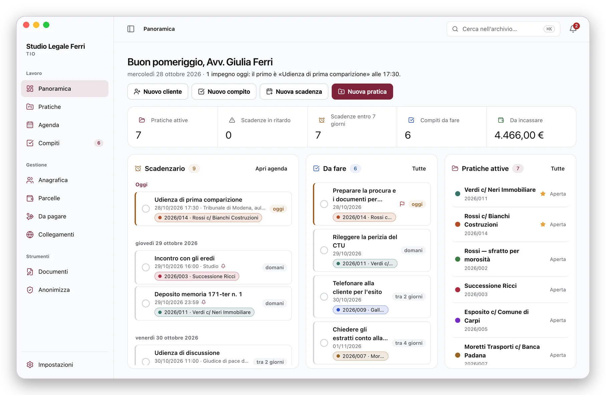
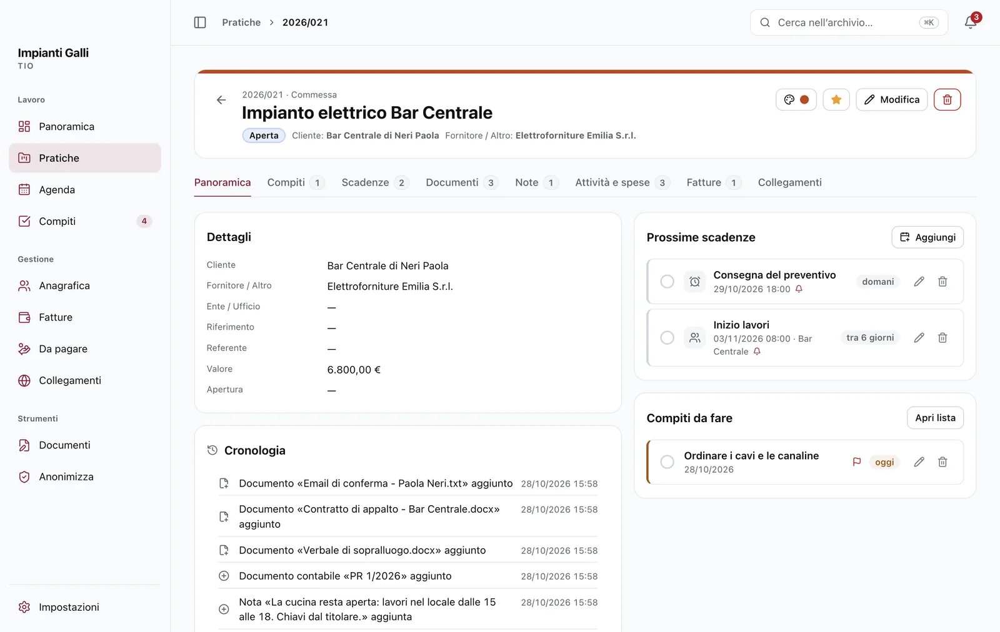
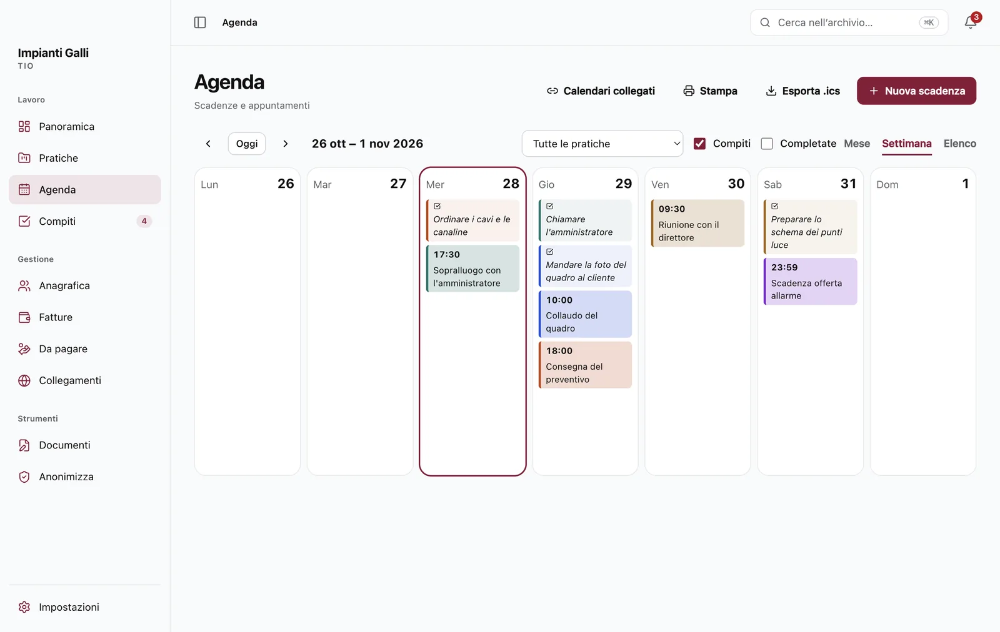
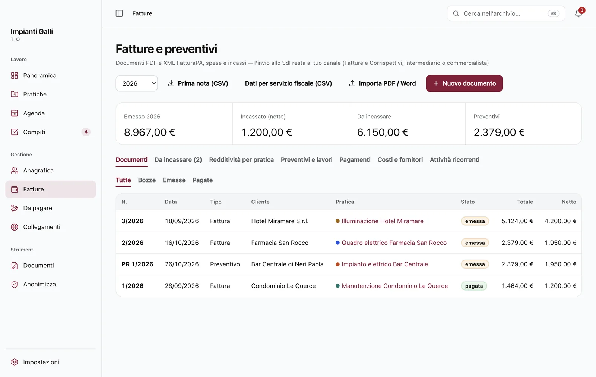
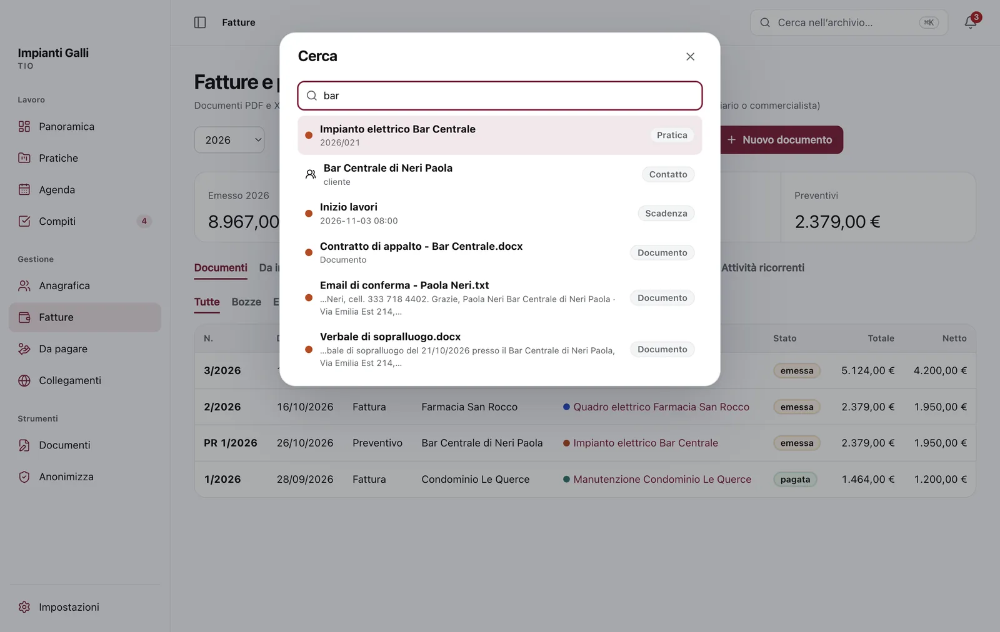
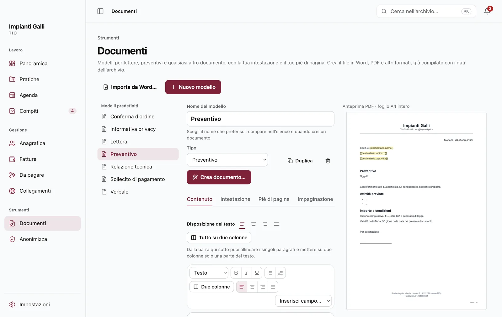
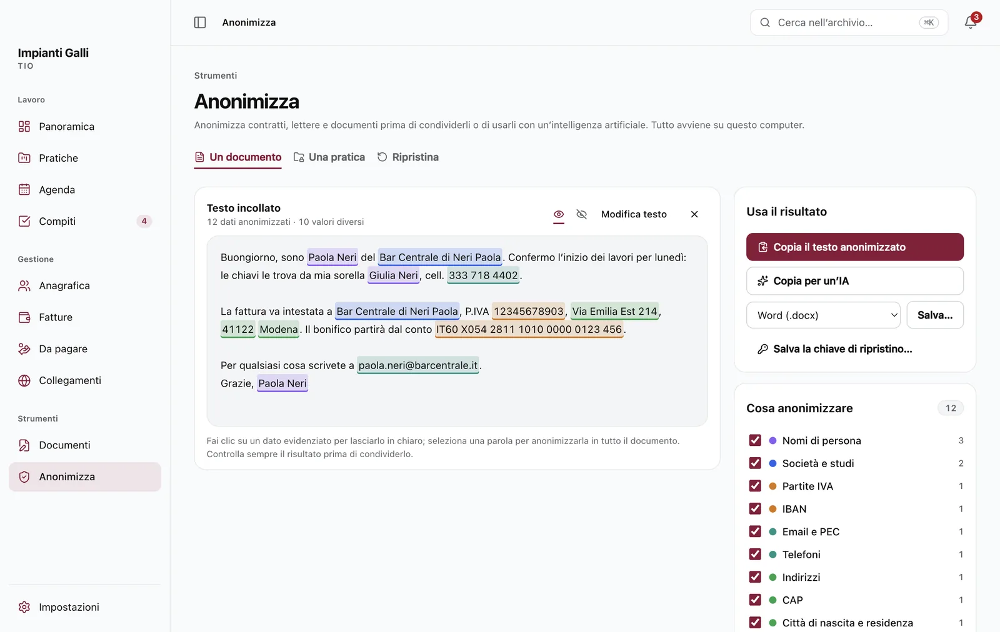

<div align="center">


# TIO — Tutto In Ordine

**Il gestionale gratuito per studi legali, liberi professionisti e ditte individuali.**<br>
Pratiche, agenda con avvisi, preventivi e fatture, documenti e anonimizzazione: tutto sul tuo computer.<br>
Senza account, senza abbonamenti, senza pubblicità. Open source.

**[Scarica TIO](https://github.com/kalkyril/tutto-in-ordine/releases/latest)** · [Sito](https://kalkyril.github.io/tutto-in-ordine/) · [Guida](https://kalkyril.github.io/tutto-in-ordine/guida/) · [Cosa fa](#cosa-fa) · [Installare](#installare) · [Privacy](PRIVACY.md)

<br>

<picture>
  <source media="(prefers-color-scheme: dark)" srcset="sito/img/readme-panoramica-scuro.webp">
  
</picture>

</div>

## Perché TIO

- **Tutto in una finestra.** Lavori, clienti, scadenze, compiti, documenti, ore e fatture dello stesso lavoro stanno insieme, a un clic di distanza.
- **Parla la tua lingua.** Al primo avvio scegli *Studio legale*, *Libero professionista* o *Ditta individuale*: pratiche, incarichi o commesse, parcelle o fatture, con aliquote e modelli adatti.
- **Ti avvisa in tempo.** Udienze, scadenze e appuntamenti con più promemoria, anche a finestra chiusa.
- **I conti in ordine.** Preventivi, fatture e note pro forma in PDF con la tua intestazione, fattura elettronica XML, incassi, solleciti e prima nota per il commercialista.
- **Documenti pronti, dati protetti.** Modelli compilati con i dati dell’archivio e uno strumento che anonimizza i documenti prima di condividerli o di usarli con un’intelligenza artificiale.
- **I dati restano tuoi.** Nessun server, nessun account, nessuna statistica. Backup automatico ogni giorno, anche cifrato. Funziona senza internet.
- **Gratis, per sempre.** Licenza MIT: il codice è pubblico e chiunque può verificarlo.

## Cosa fa

<table>
  <tr>
    <td width="50%" valign="top"><br><b>Ogni lavoro ha la sua scheda.</b><br>Cliente, scadenze, compiti, note, documenti, ore e fatture insieme; la cronologia ricorda cosa è successo e quando.</td>
    <td width="50%" valign="top"><br><b>L’agenda che ti avvisa.</b><br>Mese, settimana o elenco, con più avvisi prima di ogni impegno. Google Calendar, Outlook e iCloud compaiono accanto.</td>
  </tr>
  <tr>
    <td width="50%" valign="top"><br><b>Preventivi e fatture in PDF e XML.</b><br>IVA, contributi, ritenuta e bollo già calcolati; incassi, solleciti e prima nota per il commercialista.</td>
    <td width="50%" valign="top"><br><b>Trovi tutto in un attimo.</b><br><kbd>⌘K</kbd> sul Mac, <kbd>Ctrl K</kbd> su Windows: clienti, lavori, scadenze, compiti, note e documenti, anche dentro PDF e scansioni.</td>
  </tr>
</table>

### Strumenti

<table>
  <tr>
    <td width="50%" valign="top"><br><b>Documenti.</b><br>Lettere, preventivi, incarichi, verbali e informativa privacy con la tua intestazione, anche dalla tua carta intestata Word. Si creano già compilati in Word, PDF e altri cinque formati.</td>
    <td width="50%" valign="top"><br><b>Anonimizza.</b><br>Nomi, codici fiscali, IBAN, indirizzi e recapiti diventano segnaposto come <code>[FULLNAME_1]</code>, anche per un lavoro intero; PDF e Word mantengono l’impaginazione. Poi i dati veri tornano nella risposta dell’IA.</td>
  </tr>
</table>

### Per ogni attività

| Studio legale | Libero professionista | Ditta individuale |
| --- | --- | --- |
| Pratiche con autorità, ruolo e giudice; udienze, esito e rinvio | Incarichi con budget, ore e consegne | Commesse, forniture, manutenzioni e sopralluoghi |
| Termini processuali con sospensione feriale e festivi | Preventivi con validità ed esito, avvio dell’incarico | Preventivi e fatture con IVA e bollo |
| Compensi con i parametri del DM 55/2014 e del DM 147/2022 | Cassa o rivalsa INPS configurabili | Costi, fornitori e voci da pagare |
| Cassa Forense, conflitto di interessi, pratiche dal calendario | Scadenze fiscali e INPS gestione separata | INPS artigiani e commercianti, diritto camerale |

Il quadro completo è nella [guida](https://kalkyril.github.io/tutto-in-ordine/guida/) e nell’[elenco delle funzioni](#tutte-le-funzioni).

## Scaricare

| Sistema | File | Stato |
| --- | --- | --- |
| **macOS** 13 Ventura o successivo, Apple Silicon (M1, M2…) | `TIO-<versione>-arm64.dmg` | provato |
| **macOS** 13 o successivo, processore Intel | `TIO-<versione>.dmg` | provato in emulazione |
| **Windows** 10 o 11 a 64 bit | `TIO-Setup-<versione>.exe` | provato con le prove automatiche |

Gli installer sono nella pagina **[Releases](https://github.com/kalkyril/tutto-in-ordine/releases/latest)**, con il file `SHA256SUMS.txt` per verificare che il file scaricato sia integro e sia proprio quello pubblicato. L’app occupa circa 420 MB su Mac e 510 MB su Windows, più i tuoi dati. Non sai quale Mac hai? Menu Apple › *Informazioni su questo Mac*: «Chip Apple M…» indica Apple Silicon, «Processore Intel» un Mac Intel.

<details>
<summary>Verificare il codice SHA-256</summary>

```bash
shasum -a 256 TIO-1.0.0-arm64.dmg                  # macOS (Terminale)
certutil -hashfile TIO-Setup-1.0.0.exe SHA256     # Windows (Prompt dei comandi)
```

Il risultato deve coincidere con la riga del file in `SHA256SUMS.txt`.

</details>

## Installare

### Mac

1. Apri il file `.dmg` e trascina **TIO** nella cartella **Applicazioni**.
2. Apri TIO. La prima volta macOS dice che non può verificare l’app: TIO non passa dall’App Store e non ha una firma a pagamento di Apple. Premi **Fine**.
3. Apri **Impostazioni di Sistema › Privacy e sicurezza**, scorri fino a **Sicurezza** e premi **Apri comunque** accanto a «TIO è stato bloccato…». Inserisci la password del Mac e conferma.

Serve solo la prima volta. Su macOS 14 o precedenti basta anche clic destro sull’icona di TIO › **Apri** › **Apri**.

<details>
<summary>«TIO è danneggiato e non può essere aperto»</summary>

Di solito è il segno di un download incompleto: confronta il codice SHA-256. Se coincide, apri il Terminale e scrivi:

```bash
xattr -dr com.apple.quarantine /Applications/TIO.app
```

Il comando toglie a TIO il contrassegno «scaricato da internet» che macOS usa per bloccarlo; non modifica l’app.

</details>

### Windows

1. Scarica `TIO-Setup-<versione>.exe`. Se il browser avvisa che il file «non viene scaricato comunemente», scegli di conservarlo: in Edge menu **…** › **Mantieni** › **Mostra altro** › **Mantieni comunque**; in Chrome **Conserva** o **Scarica comunque**.
2. Fai doppio clic. Se compare **«Windows ha protetto il PC»** (SmartScreen), premi **Ulteriori informazioni** e poi **Esegui comunque**: l’avviso dipende dalla mancanza di una firma digitale a pagamento, non da un problema trovato nel file.
3. Segui l’installazione in italiano. Non servono permessi da amministratore: TIO si installa per il tuo utente, crea l’icona sul desktop e nel menu Start e alla fine si apre.

Se l’antivirus dell’ufficio blocca il file, non disattivarlo: chiedi a chi gestisce i computer di autorizzare TIO.

<details>
<summary>Protezione ransomware («Accesso alle cartelle controllato»)</summary>

Se in Sicurezza di Windows è attivo «Accesso alle cartelle controllato», Windows impedisce ai programmi non firmati di scrivere in Documenti, Desktop e Immagini. Per questo su Windows TIO tiene backup e documenti creati nella tua cartella utente (`C:\Utenti\<nome>\TIO Backup` e `…\TIO`). Se scegli di salvare un file in una cartella protetta, TIO spiega come autorizzarlo in *Sicurezza di Windows › Protezione da virus e minacce › Protezione ransomware*, oppure scegli un’altra cartella.

</details>

### Primo avvio

Scegli **Studio legale**, **Libero professionista** oppure **Ditta individuale**, scrivi il nome dell’attività (comparirà nei documenti), se vuoi il tuo nome e un colore. Tutto si cambia poi da *Impostazioni*.

- **La X non chiude TIO.** La finestra si nasconde e TIO resta attivo per gli avvisi: sul Mac nella barra dei menu, su Windows vicino all’orologio. Per uscire: **TIO › Esci** (⌘Q) sul Mac, clic destro sull’icona › **Esci** su Windows.
- **Il backup è automatico:** una copia al giorno (le ultime 7) in *Documenti › TIO Backup* sul Mac, in `C:\Utenti\<nome>\TIO Backup` su Windows. Da *Impostazioni › Backup e sicurezza* scegli un disco esterno e proteggi le copie con una password.

## La guida

TIO include una guida completa in 22 capitoli, dall’installazione al glossario, con ricerca e versione da stampare. Si apre anche senza internet da **Aiuto › Guida di TIO** (tasto **F1**), dai comandi rapidi o da *Impostazioni › Backup e sicurezza*, ed è online sul [sito](https://kalkyril.github.io/tutto-in-ordine/guida/).

## Aggiornare e disinstallare

Scarica la nuova versione e installala **sopra** quella che hai, senza disinstallare: pratiche, impostazioni e backup restano. Prima conviene fare un backup.

TIO chiede una volta, dopo il primo avvio, se vuoi essere avvisato delle nuove versioni; puoi cambiare idea in *Impostazioni › Backup e sicurezza › Aggiornamenti*. Il controllo chiede a GitHub soltanto il numero dell’ultima versione, non invia dati dell’archivio e non scarica nulla da solo. Quando c’è una versione nuova compare il riquadro «Aggiornamento» accanto a «Cerca nell’archivio…».

Per disinstallare: sul Mac trascina TIO da Applicazioni nel Cestino; su Windows *Impostazioni › App › App installate › TIO › Disinstalla*. I tuoi dati restano: per eliminarli del tutto, dopo aver salvato ciò che ti serve, cancella anche queste cartelle (l’archivio si apre da *Impostazioni › Backup e sicurezza › Apri cartella dati*).

| | Archivio | Backup automatici |
| --- | --- | --- |
| Mac | `~/Library/Application Support/TIO` | `Documenti/TIO Backup` |
| Windows | `%APPDATA%\TIO` | `%USERPROFILE%\TIO Backup` |

## Tutte le funzioni

<details>
<summary><b>Lavoro: pratiche, agenda, compiti, anagrafica, documenti</b></summary>

- **Pratiche** (o incarichi, o commesse) con colore, stato, tipologia, cliente e controparte, autorità, numero di ruolo, valore; viste a schede, elenco e per stato, preferite, ricerca e filtri.
- **Agenda** mese, settimana ed elenco: udienze, scadenze e appuntamenti con **più avvisi** (da 15 minuti a 2 settimane prima), anche con la finestra chiusa; riepilogo giornaliero, scadenze superate, stampa in PDF, esportazione `.ics`.
- **Calcolo dei termini processuali** (sperimentale): in avanti e a ritroso, sospensione feriale, festivi e sabato, con tutti i passaggi del conteggio; crea direttamente la scadenza.
- **Esito udienza:** chiudendo un’udienza annoti l’esito, fissi il rinvio e crei un compito.
- **Compiti** con scadenza, priorità e riordino trascinando; **attività ricorrenti** settimanali, mensili o annuali.
- **Anagrafica** di clienti, controparti e fornitori con dati fiscali, PEC e codice destinatario; avviso di **conflitto di interessi** se la stessa persona compare dall’altra parte in un’altra pratica.
- **Documenti collegati, non copiati:** i file restano nelle tue cartelle e TIO li ritrova anche se li sposti o rinomini. Ricerca nel testo di PDF, Word, Excel ed email; lettura delle scansioni con l’OCR italiano, tutto sul computer.
- **Attività svolte e ore** per lavoro, con allegati; **budget e consegna** con ore previste, importo concordato e confronto con il lavorato.
- **Collegamenti** ai siti che usi, in riquadri, globali o per lavoro.

</details>

<details>
<summary><b>Conti: preventivi, fatture, fattura elettronica, incassi, scadenze fiscali</b></summary>

- **Parcelle, fatture, preventivi e note pro forma** con spese generali, CPA o contributo previdenziale, IVA, spese esenti, ritenuta e bollo; PDF con la tua intestazione; importazione di riepiloghi da PDF o Word.
- **Compensi forensi** con i parametri del DM 55/2014 e del DM 147/2022 (48 competenze, valori indeterminabili compresi).
- **Spese extra:** «+ Spesa extra…» aggiunge marca da bollo, contributo unificato, diritti, visure e notifiche come spese anticipate senza IVA (art. 15), oppure carburante, trasferte, pedaggi, vitto e materiali come rimborsi con IVA.
- **Fattura elettronica (XML FatturaPA):** il file `IT<codice>_<progressivo>.xml` nel formato tra privati FPR12 (schema 1.2.3), con compensi, spese generali, CPA o rivalsa INPS, IVA o natura (N2.2 per il forfettario), spese escluse art. 15 (N1), ritenuta, bollo virtuale e pagamento con IBAN. TIO controlla i dati prima di salvare e ricorda codice destinatario e PEC di ogni cliente. **Non invia nulla allo SdI:** il file si carica su Fatture e Corrispettivi, sul servizio del tuo intermediario o si consegna al commercialista.
- **Nota di credito:** dallo storno totale di una fattura emessa, con numerazione «NC» e tipo TD04 nell’XML; la fattura diventa «stornata» e i totali la compensano.
- **Incassi:** pagamenti parziali con data e metodo, elenco da incassare con testo di sollecito, prima nota CSV per il commercialista, redditività per lavoro.
- **Preventivi e lavori:** validità ed esito; da un preventivo accettato si avvia il lavoro e si prepara il documento di vendita.
- **Costi e Da pagare:** prestazioni, consulenze, domiciliazioni, spese extra e fornitori da pagare, con scadenze, voci scadute, «Pagata» ed esportazione CSV.
- **Scadenze fiscali ricorrenti** per profilo e regime: IVA, LIPE, imposte e acconti, dichiarazioni, ritenute e CU, bollo sulle fatture elettroniche, Cassa Forense, INPS, diritto camerale. Sabati e festivi slittano al primo giorno lavorativo; verifica sempre le date con il commercialista.

</details>

<details>
<summary><b>Strumenti: Documenti e Anonimizza</b></summary>

- **Documenti** (<kbd>⌘8</kbd> / <kbd>Ctrl 8</kbd>): modelli di lettere, preventivi, diffide, procure, incarichi, verbali, relazioni o documenti liberi con intestazione, logo e piè di pagina. I campi tra doppie graffe (`{{destinatario.nome}}`, `{{pratica.rg}}`, `{{oggi}}`…) si compilano dall’archivio; quelli inventati da te li chiede TIO. Testo allineato come vuoi, anche solo una parte su due colonne. Alla prima apertura trovi i modelli del tuo profilo, tra cui l’informativa privacy (art. 13 GDPR) e l’incarico professionale con la clausola sul trattamento dei dati. **Importa da Word…** usa come modello un tuo `.docx` (per esempio la carta intestata) e ne crea copie compilate con la stessa impaginazione. Il documento si crea in Word, PDF, OpenDocument, RTF, HTML, Markdown o testo e si collega al lavoro; dalla scheda Documenti del lavoro, «Da modello…» lo crea già compilato.
- **Anonimizza** (<kbd>⌘9</kbd> / <kbd>Ctrl 9</kbd>): toglie i dati personali da un documento prima di condividerlo o di usarlo con un’intelligenza artificiale. Da PDF (anche scansionati), Word, OpenDocument, RTF, email o testo incollato, nomi, società, codici fiscali, partite IVA, IBAN, carte, recapiti, indirizzi, date, importi, targhe, documenti d’identità, numeri degli atti e dati catastali diventano segnaposto come `[FULLNAME_1]`. Riconosce clienti e controparti dell’archivio, anche dal solo cognome; un clic lascia in chiaro un dato o ne copre uno che manca. Anonimizza in una volta tutti i documenti di un lavoro, con gli stessi segnaposto e una chiave comune; salva copie di Word e PDF con la stessa impaginazione (nel PDF ogni pagina diventa un’immagine con i dati coperti, senza testo né metadati dell’originale) e, con la chiave di ripristino, rimette i dati veri nella risposta. Tutto avviene sul computer; controlla sempre il risultato.

</details>

<details>
<summary><b>Sicurezza e comodità</b></summary>

- **Sicurezza:** backup automatico giornaliero, backup cifrati con password, blocco dell’app con password (all’avvio, dopo inattività e quando blocchi lo schermo), notifiche riservate.
- **Comodità:** ricerca e comandi con <kbd>⌘K</kbd> / <kbd>Ctrl K</kbd>, scorciatoie per ogni sezione, «Annulla» dopo un’eliminazione, tema chiaro, scuro o automatico, etichette e aliquote adatte al tuo profilo.

</details>

<details>
<summary><b>Collegamenti con altri programmi</b> (sola lettura)</summary>

TIO non scrive mai in altri programmi e non chiede mai le tue password.

- **Calendari** (*Impostazioni › Integrazioni*, «Collega un calendario»): incolli il link iCal del calendario (Cliens Più: *Agenda › Esporta*; Google Calendar: *Impostazioni › il tuo calendario › Integra il calendario › Indirizzo segreto in formato iCal*; Outlook e iCloud) oppure scegli un file `.ics`. Gli impegni compaiono in agenda e negli avvisi; i link vengono riletti automaticamente. Per Cliens Cube verifica che la tua versione offra un link iCal o un’esportazione ICS compatibile.
- **Pratiche dal calendario:** con **Pratiche…** accanto a un calendario collegato, TIO riconosce nelle udienze e nelle scadenze parti, numero di ruolo, ufficio e giudice, mostra l’anteprima e importa le pratiche che scegli. Arrivano solo le pratiche riconoscibili negli eventi esportati: non è un collegamento all’archivio completo di altri gestionali e non ne importa i documenti.
- **Importazione da file** (CSV o Excel, per esempio *Esporta lista* di Cliens Più): anagrafiche, pratiche, udienze e scadenze, parcelle, con anteprima e senza doppioni.
- **Cartelle di documenti:** ogni sottocartella si abbina a un lavoro (o ne crea uno) e i file vengono collegati, mai spostati.

</details>

## Privacy e sicurezza

L’archivio è un database sul tuo computer; TIO non ha server, account, pubblicità né statistiche d’uso. Escono dati solo quando lo chiedi tu (calendari collegati, controllo facoltativo degli aggiornamenti, link che apri): tutto è descritto in [PRIVACY.md](PRIVACY.md).

L’archivio **non è cifrato**: il blocco con password impedisce l’uso dell’app, non la lettura del file. Proteggi il computer con la cifratura del disco (FileVault sul Mac, BitLocker o *Crittografia dispositivo* su Windows) e un account con password. Per le vulnerabilità vedi [SECURITY.md](SECURITY.md).

## Avvertenze

I calcoli di compensi, termini e importi fiscali sono un aiuto operativo: verificali sul caso concreto e con il tuo commercialista. TIO non trasmette fatture al Sistema di Interscambio e non fa la conservazione a norma; magazzino e DDT sono fuori dall’ambito di questa versione. È pensato per una persona su un computer e non sincronizza i dati tra dispositivi.

## Segnalare un problema

Da TIO: **Aiuto › Segnala un problema…** prepara versione, sistema e il registro degli errori (`registro.log`) da allegare. Il registro toglie percorsi e indirizzi, ma un errore può citare altri dati: controllalo prima di condividerlo. Poi apri una segnalazione nella sezione **[Issues](https://github.com/kalkyril/tutto-in-ordine/issues)**, senza dati di clienti reali. TIO non invia nulla da solo.

## Per chi sviluppa

Avvio dai sorgenti, test, creazione degli installer e pubblicazione delle versioni: [SVILUPPO.md](SVILUPPO.md). Novità di ogni versione: [CHANGELOG.md](CHANGELOG.md). TIO è fatto con Electron, React e SQLite e funziona interamente in locale.

## Ringraziamenti

Si ringrazia **Simone Rizzo** per l’ispirazione: la rete di controlli su codici fiscali, IBAN, partite IVA e carte dello strumento Anonimizza deriva da [Rizzo PII](https://rizzo-ai-academy.github.io/rizzo-pii/) (licenza MIT).

## Licenza

TIO è un progetto indipendente e gratuito di **Matteo Lugli** per la community, distribuito con [licenza MIT](LICENSE): Copyright © 2026 Matteo Lugli and TIO contributors. Le librerie e i dati di terzi mantengono le proprie licenze: vedi [THIRD_PARTY_NOTICES.md](THIRD_PARTY_NOTICES.md) e la cartella `licenses/`, consultabile anche da *Impostazioni › Backup e sicurezza › Licenze e componenti*. Apple, Mac e macOS sono marchi di Apple Inc.; Windows è un marchio di Microsoft Corporation; TIO non è affiliato né approvato da queste aziende.
